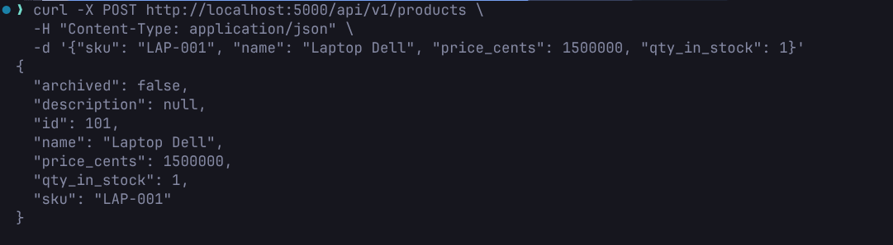
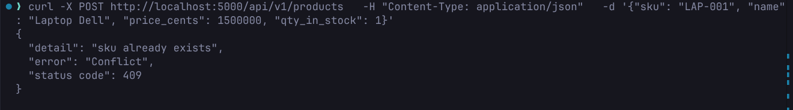
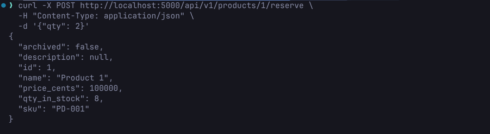
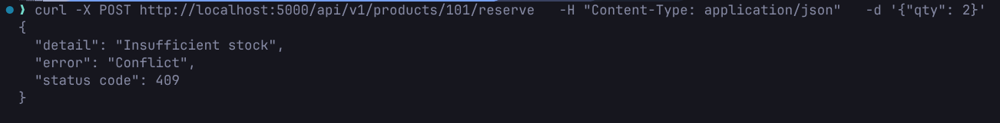

**Endpoint test**
* List products with pagination
* 
* Get product by id, fail
* 
* Post new product
* 
* Post existed product
* 
* Patch product
* 
* Delete
* 
* Purchase product
* 
* Purchase product, fail
* 