**Product Endpoint Test**
* List products with pagination
* 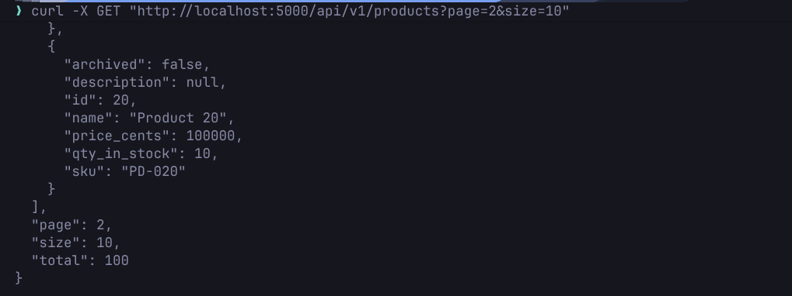
* Get product by id, fail
* 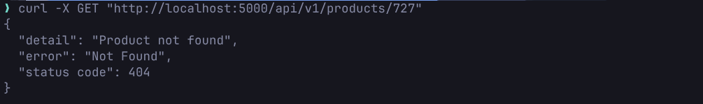
* Post new product
* 
* Post existed product
* 
* Patch product
* 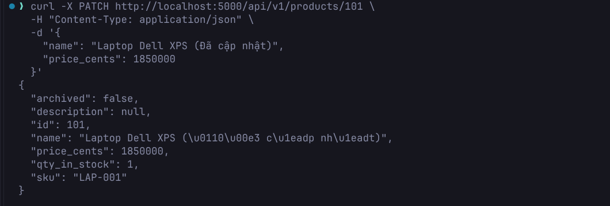
* Delete
* 
* Purchase product
* 
* Purchase product, fail
* 

**Order Endpoint Test**
* Create order
* 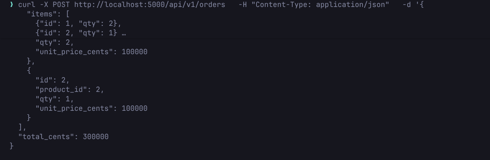
* Product not found
* 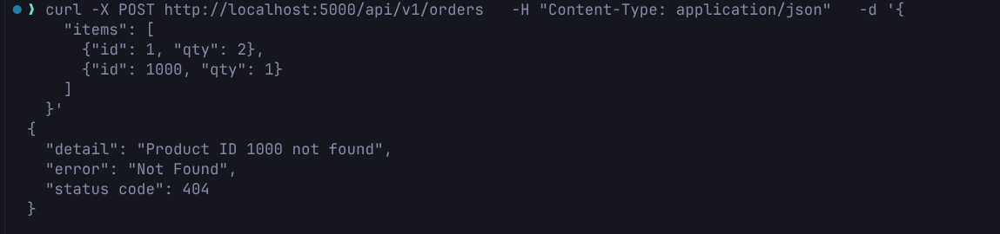
* List orders
* 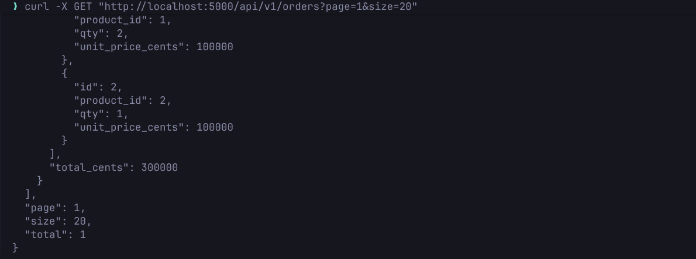
* Get order by id
* 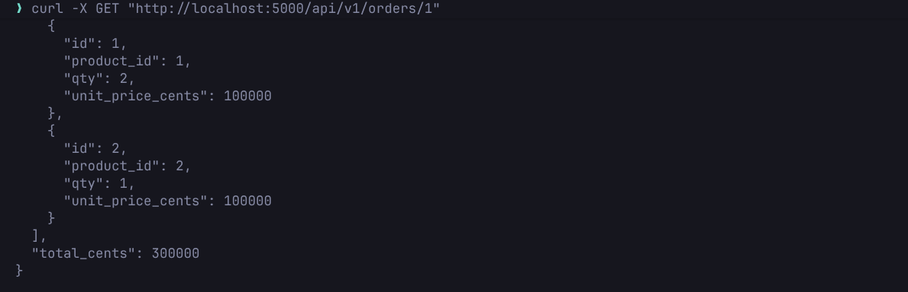
* Get order by id, fail
* 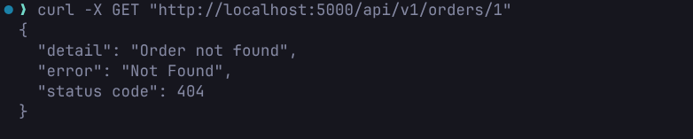
* Add product to existing order
* 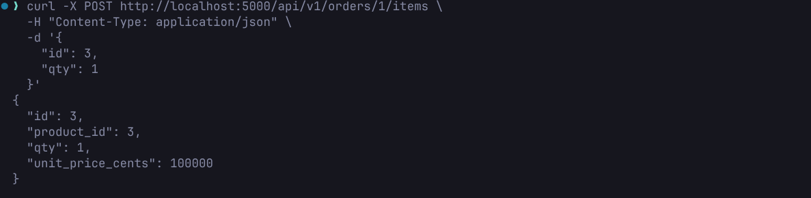
* Delete order
* 

**Healthz and Ready Endpoint Test**
* Healthz
* 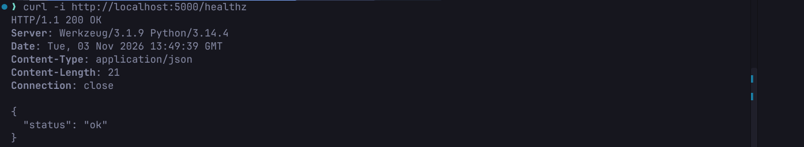
* Ready
* 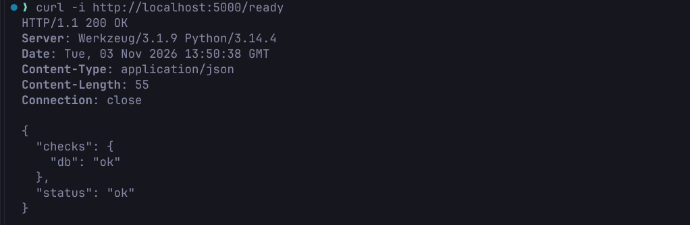

**Pytest**
* 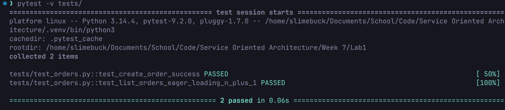