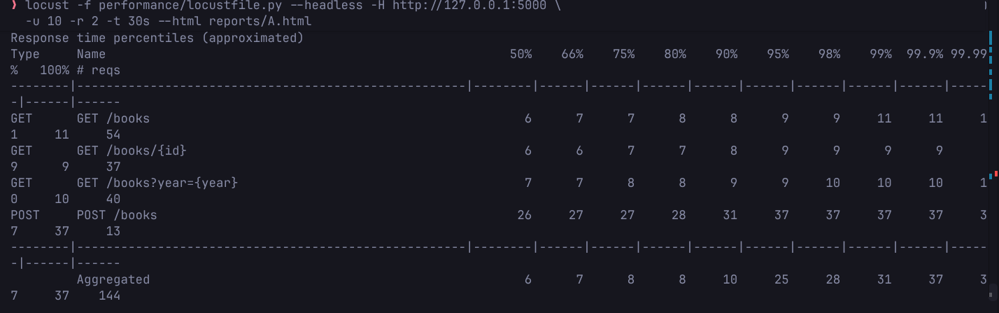
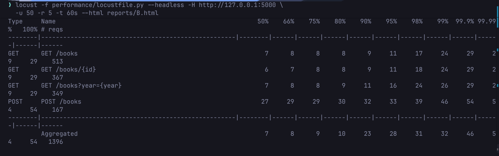
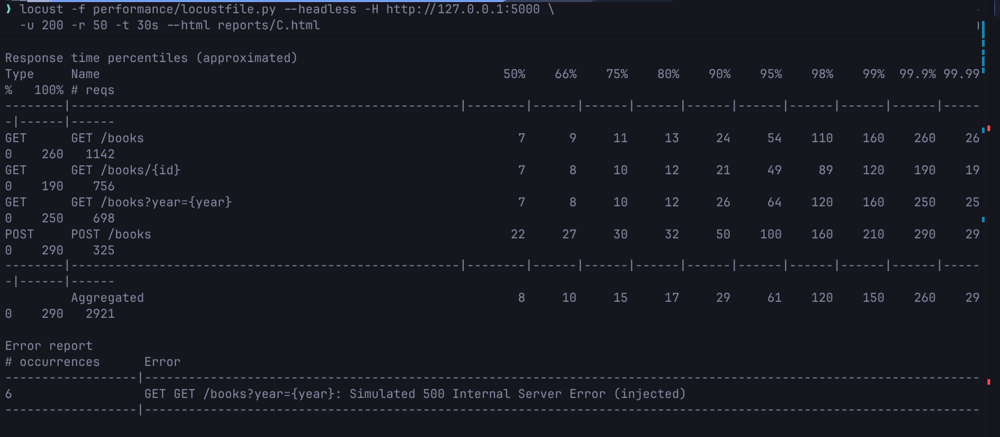

# Lab 1
## Bước 1
* 
## Bước 2
* 

# Lab 2


# Lab 3
## Yêu cầu môi trường
    * Python 3 
    * Node.js & npm 

## Cách chạy kiểm thử

    1. **Cài đặt Newman** (bỏ qua nếu đã cài):
    ```bash
    npm install -g newman
    ```

    2. **Khởi động Flask Books API** (mở một terminal riêng):
    ```bash
    python app.py
    ```
    *(Đảm bảo server đang lắng nghe tại `http://127.0.0.1:5000` khớp với `base_url` trong `local.postman_environment.json`).*

    3. **Chạy test bằng Newman và xuất file `junit.xml`**:
    ```bash
    newman run books-api.postman_collection.json \
        -e local.postman_environment.json \
        -r cli,junit \
        --reporter-junit-export junit.xml
    ```
    4. **Kết quả chạy**
    

# Lab 4
## Kết quả chạy
* baseline
    * 
* load test
    * 
* spike test
    * 
## Trả lời câu hỏi
* Câu 1: 
    * Kịch bản có p95 cao nhất: **Kịch bản C (Spike test — 200 users, spawn rate 50 users/s)** với **`p95 = 61 ms`** (cao gấp ~2,4 lần so với Kịch bản A là `25 ms` và gấp ~2,2 lần so với Kịch bản B là `28 ms`).
* Câu 2: 
    * Thực tế đo được từ 3 kịch bản: Không có endpoint nào phát sinh lỗi HTTP 5xx thật từ phía server khi tăng tải lên đến 200 users. Chỉ có endpoint **GET /books?year={year}** ghi nhận `6 lỗi` trên `698 requests (0,86%)` ở **Kịch bản C** với thông báo **Simulated 500 Internal Server Error (injected)**. Đây là **lỗi giả lập chủ động** phía client trong locustfile.py (if random.random() < 0.01: response.failure(...)) chứ không phải lỗi từ Flask.
* Câu 3:
    * Đánh giá theo SLO p95 < 300ms:

        * Kịch bản A (p95 = 25 ms): Đạt (dư biên độ an toàn rất lớn).

        * Kịch bản B (p95 = 28 ms): Đạt (hệ thống vận hành ổn định ở tải trung bình).

        * Kịch bản C (p95 = 61 ms): Đạt trên môi trường test local (61 ms < 300 ms), tuy nhiên request chậm nhất (Max = 290 ms) đã tiệm cận sát ngưỡng 300 ms nên không an toàn nếu chạy trên hạ tầng CI/container yếu hơn.
    * Đề xuất baseline cho CI gate:
        * Cấu hình chạy: Dùng mức tải tương đương Kịch bản A hoặc tải nhẹ ổn định `(locust -f performance/locustfile.py --headless -H http://127.0.0.1:5000 -u 20 -r 5 -t 30s)`. Thời gian chạy chỉ mất 30 giây, đủ phát hiện suy giảm hiệu năng (regression) mà không làm chậm pipeline CI/CD hay bị nhiễu bởi giới hạn phần cứng runner.
        * Ngưỡng chặn (Pass/Fail threshold):
            * `Aggregated p95 < 150 ms` (đặt ngưỡng cảnh báo sớm bằng một nửa SLO production 300 ms để kịp phát hiện trước khi chạm ngưỡng nguy hiểm).
            * `Server real error rate (HTTP 5xx) == 0%` (tổng fail rate toàn cục `<= 1.5%` để trừ hao 1% lỗi giả lập chủ động ở `GET /books?year={year}`).