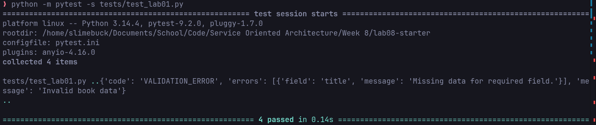
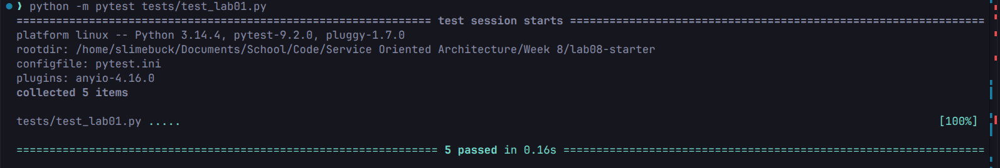
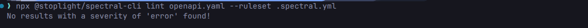
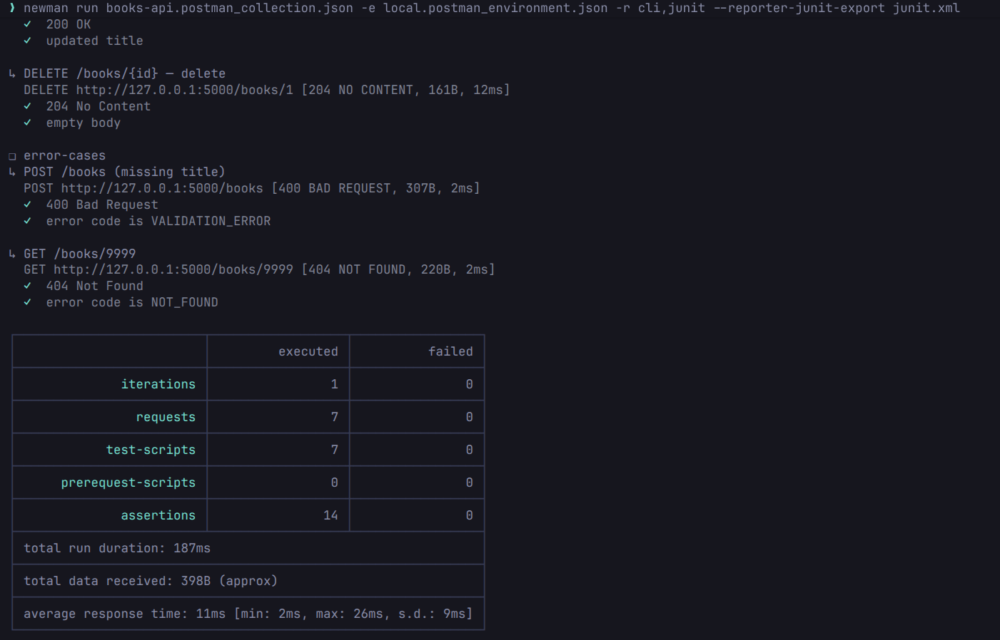

## Lab 1
* Bước 1
* 
* Bước 2
* 

## Lab 2
* 

## Lab 3

* Yêu cầu môi trường
    * Python 3 
    * Node.js & npm 

* Cách chạy kiểm thử

    1. **Cài đặt Newman** (bỏ qua nếu đã cài):
    ```bash
    npm install -g newman
    ```

    2. **Khởi động Flask Books API** (mở một terminal riêng):
    ```bash
    python app.py
    ```
    *(Đảm bảo server đang lắng nghe tại `http://127.0.0.1:5000` khớp với `base_url` trong `local.postman_environment.json`).*

    3. **Chạy test bằng Newman và xuất file `junit.xml`**:
    ```bash
    newman run books-api.postman_collection.json \
        -e local.postman_environment.json \
        -r cli,junit \
        --reporter-junit-export junit.xml
    ```
    4. **Kết quả chạy**
    